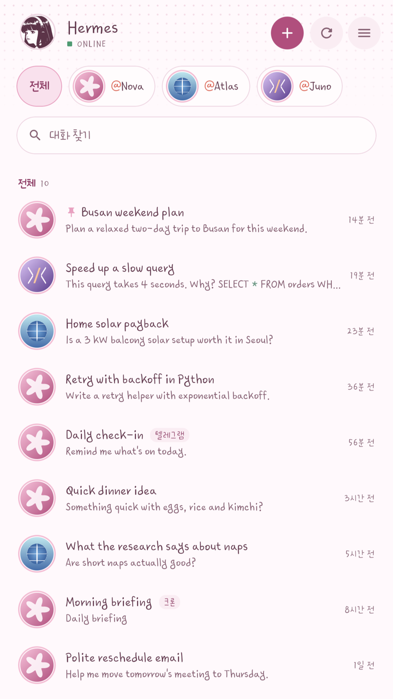
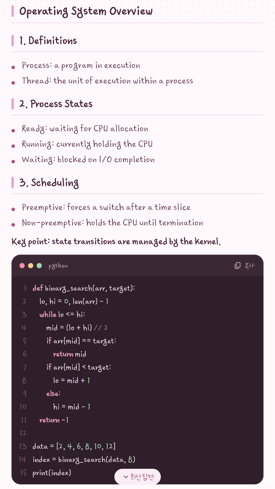
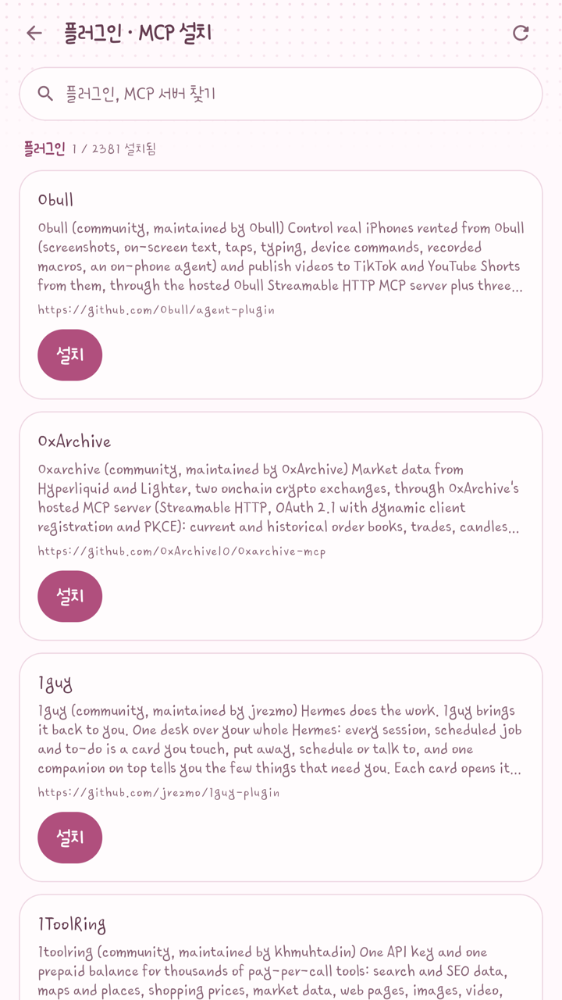
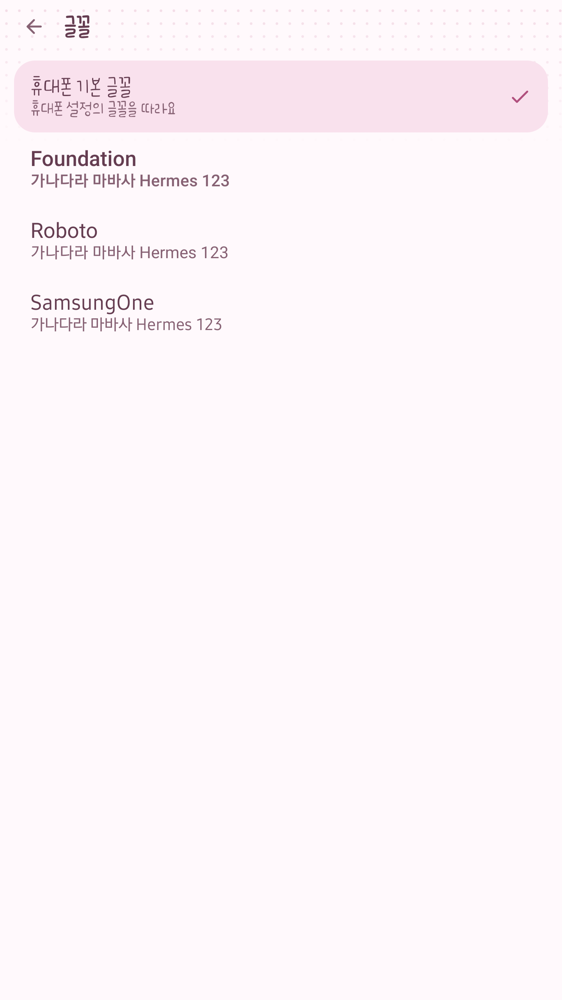

<div align="center">


# Hermes Next for iOS

**A native iPhone and iPad client for a gateway-enabled [Hermes Agent Webapp](https://github.com/NousResearch/hermes-agent).**

[](#requirements)
[](#build-from-source)
[](LICENSE)

[What it does](#what-it-does) ·
[Get started](#get-started) ·
[Limitations](#current-limitations) ·
[Build](#build-from-source)

</div>

---

Hermes Next connects directly to your Hermes server's gateway socket and HTTP
API. Chats, bots, and server-side settings stay shared with the official
Webapp and your other devices, while everyday chat happens in native SwiftUI
screens—not in an embedded web page.

## Screenshots

<table align="center">
  <tr>
    <td align="center" width="25%"><br><sub><b>Chats</b></sub></td>
    <td align="center" width="25%"><br><sub><b>Conversation</b></sub></td>
    <td align="center" width="25%"><br><sub><b>Plugins and MCP</b></sub></td>
    <td align="center" width="25%"><br><sub><b>Fonts</b></sub></td>
  </tr>
</table>

| | |
|---|---|
| **Bundle ID** | `dev.hermes.next` |
| **Version** | `1.0.0` |
| **Platforms** | iPhone and iPad, iOS 17 or later |
| **Server** | A signed-in Hermes Agent Webapp with `/api/webapp/socket-ticket` and `/api/ws` |

## Requirements

- An iPhone or iPad running iOS 17 or later.
- A Hermes Agent Webapp server with gateway endpoints enabled.
- An account that can sign in to that server.

## What it does

- **Native conversations.** Browse every bot's chats, start a new one, search
  titles and message text, and receive streamed answers as they are written.
- **Useful chat controls.** Stop a turn; approve or deny a command; rename,
  pin, archive, restore, or delete chats. Those changes are saved on the
  server, so they appear on other clients.
- **A clear overview.** Chats are organized into bot, app, messaging-platform,
  and cron sections. Unread or actively writing chats are visibly marked.
- **Readable output.** Markdown answers support headings, lists, quotes,
  tables, and syntax-coloured code blocks with line numbers and copy controls.
- **Bot-aware navigation.** Switch between the all-chats view and a tab for
  each bot. A new chat uses the bot in the current tab.
- **Server tools.** Browse and search cron jobs, skills, toolsets, MCP servers,
  plugins, and MCP catalog entries. Run, pause, or resume cron jobs; install
  catalog entries after confirmation.
- **Personal presentation.** Choose an installed iOS font or import TTF, OTF,
  and TTC files. The chosen font is registered before the first screen draws.
- **Designed for iPad.** The chat list and conversation appear side by side on
  iPad; message text is kept to a readable width.

## Get started

1. Run Hermes Agent's official Webapp on a computer or server you control, and
   make it reachable from the device—prefer HTTPS or a trusted private network.
2. Install or build Hermes Next, then enter the server's base address, for
   example `https://hermes.example.com`.
3. Tap **Sign in** and complete authentication on the server's own page.
4. Return to Hermes Next. The app validates the endpoint, opens its native
   chat view, and reconnects whenever it returns to the foreground.

The app accepts `http` and `https` addresses, but HTTPS is strongly recommended
outside a private development network. Do not use a temporary sign-in URL as
the saved server address.

## Current limitations

This is a foreground-focused native client. iOS can suspend network work after
an app enters the background, so Hermes Next does not promise background
gateway monitoring or push notifications.

The following remain in the official Webapp for now:

- photo attachments and model selection;
- answering free-form clarification questions;
- any server feature that is not exposed by the native menu.

The gateway protocol used by Hermes is not a public, stable API. Update this
app alongside Hermes Agent when a server release changes gateway behaviour.

## Privacy and data

- Hermes Next connects only to the server address you save. It contains no
  analytics, advertising, or crash-reporting service.
- Authentication cookies are retained in the iOS Keychain. The app refreshes
  its stored copy after server responses so rotated sign-in cookies survive an
  app restart.
- The saved server address, draft, recent preview lines, selected font, voice
  settings, and imported fonts live in the app's own storage. Bot images are
  cached locally. A Gemini API key, used only for the live voice call, is
  stored in the Keychain. Voice audio is sent to Google when a call is placed.
- The microphone is used only during a voice call. Background audio keeps that
  call, and the Hermes hand-off inside it, alive when the screen locks.
- Conversation content is sent to and retained by the Hermes server you choose;
  secure that server and its network route accordingly.

## Build from source

### Xcode

Open `HermesNext.xcodeproj` in Xcode 16 or later, select the **HermesNext**
target, choose your signing team under **Signing & Capabilities**, then run it
on an iPhone, iPad, or simulator.

### Command line

Build a simulator target:

```sh
xcodebuild -project HermesNext.xcodeproj -scheme HermesNext \
  -sdk iphonesimulator -destination 'generic/platform=iOS Simulator' build
```

Build an unsigned device archive for CI or later signing:

```sh
xcodebuild -project HermesNext.xcodeproj -scheme HermesNext \
  -sdk iphoneos -configuration Release -destination 'generic/platform=iOS' \
  -derivedDataPath build CODE_SIGNING_ALLOWED=NO build
```

To put a build on a physical device, sign it with an Apple development or
distribution certificate. Sideloading tools can re-sign an IPA with their own
certificate; their device and account limits are determined by Apple and the
tool you choose.

GitHub Actions builds an unsigned Release IPA on a macOS runner
(`.github/workflows/ios-ipa.yml`). The artifact is `HermesNext-unsigned`
(`HermesNext-unsigned.ipa`). It is not signed: install it with a free personal
team in Xcode, or re-sign it with your own certificate. No secrets are used.

## Project map

| Path | Responsibility |
|---|---|
| `HermesNextApp.swift` | App lifecycle, endpoint setup, and the server sign-in sheet |
| `Server.swift` | HTTP requests, endpoint parsing, cookie storage, and API response parsing |
| `Store.swift` | Gateway WebSocket, chat state, and server actions |
| `ChatListView.swift` | Chat list, search, bot tabs, and chat actions |
| `ConversationView.swift` | Transcript, streaming responses, approvals, and composer |
| `MenuView.swift` | Cron, capabilities, catalog installs, archives, fonts, and server settings |
| `Markdown.swift`, `MarkdownView.swift` | Markdown parsing and rendering |
| `Fonts.swift`, `Theme.swift` | Font registration, colour palette, and shared controls |
| `Voice/` | Live call screen, Metal aura, audio, Gemini socket, and voice settings |
| `HermesVoiceCore/` | Call state machine, protocol, captions, and settings codec (Swift package) |

## Credits and license

The colour palette and app icon are derived from
[hermes-android](https://github.com/hermes-webui/hermes-android) (MIT).
Hermes Next is independent of and not affiliated with Nous Research.

Licensed under the [MIT License](LICENSE).
